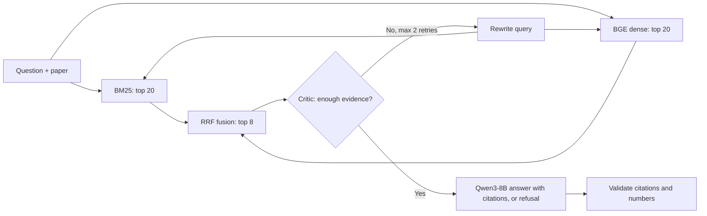
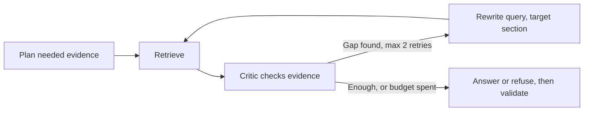

# AI6127 Assignment - Editable Working Copy

> **Updated 2026-11-05, from commit `ceeaca8` (branch `p6/report-prep`, same code as the latest `main` merge, PR #49).** Assignment prompts are unchanged; the answers sit under each question. All scores below are **development results**. The final evaluation run has not happened yet, so nothing here is a final held-out result.

## Results at a glance

| Question | Status | Headline |
| --- | --- | --- |
| Q1 Knowledge base | Done | 28,617 passages from 1,584 NLP papers; 5.66M source words; 210,909 word types |
| Q2.1 UI | Done | Streamlit app with paper or all-papers search, citations and warnings |
| Q2.2 Five queries | Done (school GPU, all papers) | 5 live browser queries, all answered; 19.9 s mean with `Qwen3-8B`; first retrieval 0.2-0.5 s |
| Q3 Retrieval | Done on draft gold | Hybrid RRF is best at MRR@5 = 0.804; reranker lowered quality, so it was dropped |
| Q4.1-4.2 Generation, preprocessing | Done | Qwen3-8B answers only from cited passages, or refuses |
| Q4.3 Labelled dataset | Done, team sign-off pending | 1,853 pairs; 89.85% agreement (target 80%) |
| Q4.4 EM / F1 | **Not run** | Scorer ready; waiting for the final answer files |
| Q4.5 RAGAS | **Not run** | Scorer ready; judge model, API key and budget not chosen |
| Q4.6 Performance | Partial | Component and local timings exist; final batch throughput pending |
| Q5 Innovations | Partial | Adaptive retries gave no gain over reading more passages; 2×2 ablation not run |

**Terms used**

- **Passage / chunk:** a short slice of a paper, the unit the system searches.
- **Development result:** measured on data used while building the system, so it may be optimistic.
- **Held-out result:** measured once on questions kept aside after all settings are frozen.
- **Gold:** the human-approved correct labels.
- **Confidence interval (CI):** the likely range of a result. If a difference's CI includes 0, we report no clear difference.

**Final system (top-8, no reranker):**

## 1 Objective

In this group assignment, you will build a retrieval-augmented generation (RAG) system for a natural language processing task of your choice. You are free to pick any downstream task that retrieved evidence can serve, e.g., open-domain question answering, summarization, fact-checking, semantic search, recommendation, or sentiment and opinion analysis (for instance, a system that finds relevant opinions about any instance of a topic of your choice, such as bitcoin within the topic of cryptocurrencies, and reports that they are 70% positive and 30% negative). Whatever task you choose, the heart of your system must be the retriever-generator contract of this course: a knowledge base that is gathered and indexed offline, a retriever that locates the most relevant evidence for a query, and a generator (or classifier) that produces the final answer conditioned on that evidence. Once you have chosen a task and a domain, make sure that a) you can gather enough data about it (e.g., some topics may be too niche to the point that you would only find a few hundreds documents about it) and b) the data are suitable and balanced for the task (e.g., for sentiment analysis, if the topic you chose only has negative opinions associated with it, it’s probably not a good topic). For ideas about interesting topics, you can check our project page at https://sentic.net/projects. You are pretty much free to use anything you want in terms of available tools/libraries. However, your system cannot be just a mashup of existing services or a single call to a hosted RAG API: you must implement, and be able to explain, the retrieval and generation stages yourselves. Your final score will depend not only on how you developed your system but also on its novelty and your creativity: in other words, to get a high score you do not only need to implement a system that works, but also a system that is useful and user-friendly.

## 2 Deadline and Grouping

- The assignment constitutes 35% of your total grade for the course. 
- Report submitted by 7th November at 11:59pm SGT.  
- The main tasks of the assignment are knowledge-base construction (20 points), retrieval (40 points) and the downstream task with generation (40 points). 

## 3 Tasks and Questions

### 3.1 Knowledge-Base Construction (20 points)

Assemble the corpus that your system will retrieve from. Gather text data from any sources which you are interested in and permitted to access, e.g., Reddit API or a public dataset, and/or combine them with ready-made datasets. The corpus should have at least 10,000 documents (or passages) and at least 100,000 words. It is OK to use available datasets for training or as background knowledge (e.g., popular sentiment benchmarks or datasets from the Hugging Face Hub), but you still have to at least gather and label a held-out test set yourselves. For your own evaluation dataset, make sure it does not contain duplicates and try your best to make it balanced (e.g., an equal number of positive and negative entries for sentiment). For a classification task, use the same tabular format as the above-mentioned sentiment benchmarks and name it “eval.xls” (using a different format will result in demerit points); for other tasks, use an appropriate standard format (e.g., JSONL) and document it. Because a generator will read what you retrieve, you must also clean and chunk the raw documents into passages of a sensible size, which is itself a design choice discussed in the course. You can use any third-party libraries for gathering and preparing the data, e.g.:

- Hugging Face Datasets: https://huggingface.co/datasets

- Kaggle Datasets: https://www.kaggle.com/datasets

- Common Crawl: https://commoncrawl.org

- Wikimedia dumps: https://dumps.wikimedia.org

- Scrapy: https://scrapy.org

- Beautiful Soup: https://www.crummy.com/software/BeautifulSoup

- Trafilatura: https://trafilatura.readthedocs.io

- Playwright: https://playwright.dev

- PRAW (Reddit): https://praw.readthedocs.io

Note that access to social-media data has tightened in recent years: the X (formerly Twitter) API now requires a paid tier and several platforms have restricted their public APIs, so prefer open datasets and permissively licensed sources, and always respect each source’s terms of use and rate limits.

### Question 1

Explain and provide the following:

#### Q1.1

How you gathered the corpus (e.g., source, keywords, API, library), and how you cleaned, chunked, and stored it

**Status:** Done.

**Source.** We use the full text of NLP papers from the public QASPER dataset (`allenai/qasper`, pinned to revision `fdc9d82`). No scraping or keywords were needed. The download checks archive fingerprints and parses files locally ([src/data/qasper.py](../src/data/qasper.py)).

| Step | What we did | Why |
| --- | --- | --- |
| Separate | Paper text goes to `papers.jsonl`; questions and answers go to `qa.jsonl` | Answers must never enter the search index |
| Clean | Standardise line endings, trim outer spaces, drop empty containers | Keeps formulas, numbers and case intact |
| Chunk | 365-word windows with 40-word overlap, never crossing a section | Keeps each passage on one topic |
| Store | JSONL plus a manifest of hashes, settings and counts | Anyone can verify the exact corpus |
| Index | BM25 built from text; BGE vectors in one FAISS index per paper | Supports lexical and semantic search |

Each passage has eight fields: `passage_id`, `paper_id`, `title`, `section`, `chunk_number`, `text`, `prev_passage_id`, `next_passage_id`. Abstracts and figure or table text are not indexed. The schema stays `v0-proposed` until the team confirms it. Q3 explains how 365/40 was chosen.

#### Q1.2

Which task users will perform over your corpus (i.e., the application), with sample queries or inputs

**Status:** Done.

**Application.** Users ask questions about NLP research papers: methods, experiments, results and comparisons. PaperGap finds evidence, checks whether it is enough, then answers with citations or refuses. A user can search one paper or all papers.

**Sample queries** (development questions, also used in Q2.2):

| Paper | Query |
| --- | --- |
| `1912.10167` | Are any experiments performed to try this approach to word embeddings? |
| `1911.07555` | What evaluation metric is used? |
| `1904.10503` | What results do they achieve using their proposed approach? |
| `1904.05584` | Which model architecture do they use to obtain representations? |
| `1912.01046` | What evaluation metrics were used in the experiment? |
| All papers | What methods are used for low-resource language identification? |

Questions with words like "they" or "this approach" need a selected paper. The formal evaluation is one-paper search only.

#### Q1.3

The numbers of documents (and chunks), words, and types (i.e., unique words) in the corpus

**Status:** Done. Both corpora pass the minimum of 10,000 passages and 100,000 words.

| Measure | Development corpus | Full corpus (used for final run) |
| --- | ---: | ---: |
| Papers in source | 1,169 | 1,585 |
| Papers with passages | 1,168 | 1,584 |
| Passages (chunks) | 21,360 | **28,617** |
| Source words | 4,262,446 | **5,659,921** |
| Words in passages, counting overlap twice | 4,469,326 | 5,930,961 |
| Types (unique words) | 174,636 | **210,909** |

- **Split:** the development corpus holds official train + validation text (16,457 + 4,903 passages). The full corpus adds 7,257 test passages.
- **Word rule:** a word is any run of non-space characters. A type is a lowercased word, and punctuation stays attached, so types are not a dictionary vocabulary.
- **Questions:** the export also has 5,049 questions and 7,993 answer annotations, which are not corpus documents.
- **Hashes (SHA-256):** development `ecb1c601…`, full `8eeef011…`.

### 3.2 Retrieval (40 points)

Retrieval: Build a retriever over your knowledge base. At a minimum, implement both a sparse (lexical) retriever and a dense (embedding) retriever, and combine them into a hybrid pipeline, optionally followed by a re-ranker, exactly the design developed in this course. You can build each stage from scratch or use some combination of available tools. Useful components include:

- Elasticsearch / OpenSearch (inverted index, BM25): https://www.elastic.co, https://opensearch.org

- Apache Solr / Lucene: https://solr.apache.org, https://lucene.apache.org

- Pyserini (reproducible BM25 and dense retrieval): https://github.com/castorini/pyserini

- Sentence-Transformers (SBERT embeddings): https://sbert.net

- Hugging Face Transformers (BGE, GTE, E5 encoders): https://huggingface.co/models

- FAISS (similarity search library): https://github.com/facebookresearch/faiss

- Vector databases: Chroma, Qdrant, Weaviate, Milvus, pgvector

- RAG orchestration frameworks: LangChain, LlamaIndex, Haystack, DSPy

You can also choose any other inverted-index or vector-search open project. However, you should NOT simply adopt SQL-based solutions for text search (for example, you CANNOT solve retrieval simply using a LIKE query in Microsoft SQL Server or MySQL).

Querying: You need to provide a simple but friendly user interface (UI) for querying. It could be either a web-based or mobile app based UI. Lightweight options such as Streamlit or Gradio let you build one in a few lines; FastAPI or Django are options for a fuller web app. The UI must be kept simple. A sophisticated UI is not necessary nor encouraged (as it is not the focus of this course). Detailed information besides text is allowed to be shown for the query results, e.g., images, ratings, timestamps, and source links. The details should be designed to solve specific problems.

### Question 2

Perform the following tasks:

#### Q2.1

Design a simple UI (you can design one from scratch or you can tap on an existing one) to allow users to query your system in a simple way

**Status:** Done. The UI is merged in [src/ui/app.py](../src/ui/app.py). A rehearsal of the final configuration is still needed (see Submission status).

**PaperRAG** is a Streamlit app that talks to a FastAPI service.

| UI feature | Problem it solves |
| --- | --- |
| Question box and example library | Users can start without knowing the system |
| Search scope: All papers or One paper | Vague questions can be tied to one paper |
| Sources with expandable passage text | Users can check every citation |
| Evidence status and warnings | Weak answers are visible, not hidden |
| Refusal shown as a normal answer | "Not enough evidence" is different from a system error |
| Pipeline details and history | Shows retrieval rounds; history lasts for the session only |

The UI calls `/health`, `/papers`, `/answer` and `/passages`. Each question is answered independently, with no chat memory.

#### Q2.2

Write five queries, get their results, and measure the speed of the querying

**Status:** Done on the school GPU, all papers, run on 2026-11-07 through the browser UI at commit `a9d2743` with the new sample questions, against the live P5 API.

**Setup:** School GPU (node TC2N03; job number not in the run files), `Qwen3-8B` via vLLM, top-8 RRF, no reranker, no separate warm-up, serial, through the SSH tunnel. Raw output and screenshots are in `results/p6-ui-verification-20261107-gpu-all-papers/`.

| # | Question | Grounding (checked against cited passages) | Rounds | Citations | Warnings | Time (s) |
| --- | --- | --- | ---: | ---: | ---: | ---: |
| 1 | Entity-linking context | Partly: coherence supported, local context omitted | 1 | 4 | 1 | 19.3 |
| 2 | Commonsense in dialogue | Not grounded: cited passages do not mention dialogue | 1 | 2 | 2 | 15.1 |
| 3 | MT with limited parallel data | Grounded | 1 | 3 | 0 | 17.9 |
| 4 | CFG induction | Partly: compound-PCFG claim cites the wrong paper; no papers named in the text | 1 | 3 | 1 | 20.9 |
| 5 | Low-resource language identification | Partly: methods real but not low-resource specific; x-vector claim cites unrelated passages | 3 | 3 | 2 | 26.3 |

| Speed | Value |
| --- | --- |
| Full answer, mean / median | 19.9 s / 19.3 s |
| Full answer, range | 15.1-26.3 s |
| Serial rate (not measured batch throughput) | 0.050 questions/s (5 in 99.5 s) |
| Final generation | 69.9 of 99.5 s |
| First retrieval after submission | 0.2-0.5 s (0.1 s log resolution) |
| Citation lookup | 92-148 ms |

**Earlier selected-paper GPU run, kept separate.**

Run on 2026-11-07 from the UI at commit `58a3aaa` against the live P5 API.

**Setup:** School GPU (job 51905, node TC2N01), `Qwen3-8B` via vLLM, 2,500 characters inferred, warmed service, five development questions, serial, through the SSH tunnel. Raw output is in `results/p6-ui-verification-20261107-gpu/`.

| # | Paper | Answer (short) | Outcome | Rounds | Citations | Time (s) |
| --- | --- | --- | --- | ---: | ---: | ---: |
| 1 | `1912.10167` | Yes | Answered, 1 warning | 1 | 3 | 19.7 |
| 2 | `1911.07555` | Classification accuracy | Answered, 2 warnings | 3 | 2 | 17.1 |
| 3 | `1904.10503` | F1 of 88% on OntoNotes and 53% on Wiki(gold) | Answered, no warnings | 1 | 1 | 16.2 |
| 4 | `1904.05584` | BiLSTM with max pooling | Answered, 1 warning | 1 | 1 | 11.5 |
| 5 | `1912.01046` | Accuracy and MRR | Answered, 1 warning | 1 | 1 | 10.8 |

| Speed | Value |
| --- | --- |
| Full answer, mean / median | 15.1 s / 16.2 s |
| Full answer, range | 10.8-19.7 s |
| Serial rate (not measured batch throughput) | 0.066 questions/s (5 in 75.3 s) |
| Retrieval call, median over 7 calls | 111.5 ms (range 68.1-204.0 ms) |

**How to read the GPU run**

- **Budget:** the service does not report its budget. 2,500 is inferred: each prompt is exactly 4 tokens below the matching local 2,500 run, and query 5 answers.
- **Warm-up:** one separate question (31.7 s) is excluded.
- **Evidence:** all citations resolved to the selected paper. The source tree had staged documentation edits only; the code was `58a3aaa`.
- **Limits:** one pass gives a typical time, not a reliable p95. Other GPU use during the run was not checked.

**Laptop run, kept separate.** Run on 2026-11-06 at commit `58a3aaa`.

**Setup:** Local Apple M5, `qwen3:14b`, 2,500 characters via local setting, warmed service, five development questions, serial. Raw output is in `results/p6-ui-verification-20261106-2500-clean/`.

| # | Paper | Answer (short) | Outcome | Rounds | Citations | Time (s) |
| --- | --- | --- | --- | ---: | ---: | ---: |
| 1 | `1912.10167` | Yes; accuracy was checked on an unused subset against Google Translate | Answered, 2 warnings | 1 | 1 | 106.9 |
| 2 | `1911.07555` | Average classification accuracy | Answered, 2 warnings | 3 | 1 | 100.2 |
| 3 | `1904.10503` | F1 of 88% on OntoNotes and 53% on Wiki(gold) | Answered, no warnings | 1 | 1 | 165.5 |
| 4 | `1904.05584` | BiLSTM with max pooling | Answered, 1 warning | 1 | 1 | 98.4 |
| 5 | `1912.01046` | Accuracy and MRR | Answered, 1 warning | 1 | 1 | 109.1 |

| Speed | Value |
| --- | --- |
| Full answer, mean / median | 116.0 s / 106.9 s |
| Full answer, range | 98.4-165.5 s |
| Serial rate (not measured batch throughput) | 0.0086 questions/s (5 in 580.1 s) |
| Retrieval call, median over 7 calls | 39.3 ms (range 23.6-286.1 ms) |

**Earlier run, kept separate.** The 2026-11-05 run at commit `ceeaca8` used 1,200 characters per passage. Raw output: `results/p6-local/five-queries-20261105.json`.

| # | Paper | Answer (short) | Outcome | Rounds | Citations | Time (s) |
| --- | --- | --- | --- | ---: | ---: | ---: |
| 1 | `1912.10167` | Yes; a linear mapping between language vector spaces, checked against Google Translate | Answered, 2 warnings | 1 | 4 | 174.2 |
| 2 | `1911.07555` | Average classification accuracy | Answered, 2 warnings | 3 | 1 | 98.7 |
| 3 | `1904.10503` | F1 of 88% on OntoNotes and 53% on Wiki(gold) | Answered, no warnings | 1 | 1 | 159.5 |
| 4 | `1904.05584` | BiLSTM with max pooling | Answered, 1 warning | 1 | 1 | 104.6 |
| 5 | `1912.01046` | Insufficient evidence | **Refused** | 1 | 0 | 76.3 |

| Speed | Value |
| --- | --- |
| Full answer, mean / median | 122.7 s / 104.6 s (4 answered, query 5 refused) |
| Full answer, range | 76.3-174.2 s |
| Serial rate | 0.008 questions/s (5 in 613.3 s) |
| Retrieval call, median over the 7 scored calls | 31.4 ms (range 15.1-269.0 ms) |

**How to read this**

- **Setup details:** Apple M5, 24 GB, 8 passages, no reranker, local Ollama `qwen3:14b`. The final system uses `Qwen3-8B` on a GPU, so these times describe the laptop, not the final system. One pass of five questions gives a typical time, not a reliable p95.
- **Bottleneck:** almost all the time is LLM work; retrieval is under 1% of it.
- **Warm-up:** in the 2026-11-06 run, one separate question (151.2 s) warmed the service and is excluded. In the 2026-11-05 run, one earlier query (203.9 s) loaded the models and is excluded.
- **Query 1 check:** the 2,500 answer is supported by its cited passage and matches the QASPER yes/no reference. Its warnings are kept.
- **Follow-up verification (6 November):** the four generated answers were checked against cited passages and the five matching QASPER reference rows. Query 5 is answerable and its refusal is a missed answer. The original citation lookup requests failed with HTTP 400; a fresh five-run UI verification resolved all seven citations successfully. Keep the original timings above separate from the new run. See [verification and teammate handoff](P6/FIVE_DEMO_VERIFICATION.md).
- **Warnings:** they are heuristic flags. For example, query 2 was answered although the critic still judged the evidence incomplete.

### Question 3

Explore some innovations for enhancing the retrieval and ranking. Explain why they are important to solve specific problems, illustrated with examples. You can list anything that has helped improving your system from the first version to the last one, plus queries that did not work earlier but now work because of the improvements you made. Because retrieval sets a ceiling on everything downstream, evaluate it explicitly with rank-aware measures such as Precision@K, Recall@K, Mean Reciprocal Rank, and Normalized Discounted Cumulative Gain (e.g., using ir measures, BEIR, or MTEB for embedding quality). Possible innovations include (but are not limited to) the following:

- Hybrid fusion (e.g., reciprocal rank fusion of sparse and dense results)

- Re-ranking (e.g., a cross-encoder or a learned re-ranker over the top candidates)

- Query expansion or rewriting (e.g., pseudo-relevance feedback, or HyDE-style hypothetical documents)

- Timeline and metadata search (e.g., allow users to search within specific time windows or categories)

- Multimodal search (e.g., implement image or table retrieval alongside text)

- Multilingual search (e.g., enable your system to retrieve data in multiple languages)

- Chunking and indexing strategies (e.g., semantic chunking or parent-document retrieval)

**Status:** Done on draft gold. Scores are development results until the team signs off the labels and the question freeze.

**Innovations tried**

| Innovation | Problem it targets | Result | Decision |
| --- | --- | --- | --- |
| Hybrid RRF (BM25 + BGE, k = 60, 20 candidates each) | Keywords miss paraphrases; embeddings miss exact names; their scores are not comparable | Clearly beats BM25; no clear difference from Dense | **Keep** |
| BGE cross-encoder reranker | Reorder candidates more precisely | Clearly worse than RRF on all four metrics | **Remove** |
| Deeper retrieval (top-5 to top-8) | Answers often sit below rank 5 | Evidence recall 0.740 to 0.885 | **Keep** |
| Chunk-size tuning | Chunks too small split evidence; too large waste budget | 365 words chosen as a practical trade-off | **Keep** |
| Gap-directed query rewriting and section targeting | First query misses a specific fact | No gain at equal passages (see Q5) | Keep in adaptive arm, reported honestly |

**Evaluation data.** 200 questions from 174 papers. Each method's saved top-5 was scored against 1,853 labelled pairs, using `results/p6/retrieval-draft-v3/`.

| Method | P@1 | P@5 | Pool Recall@5 | MRR@5 | Pool nDCG@5 |
| --- | ---: | ---: | ---: | ---: | ---: |
| BM25 | 0.600 | 0.482 | 0.607 | 0.730 | 0.636 |
| Dense | 0.685 | 0.527 | 0.698 | 0.799 | 0.719 |
| **Hybrid RRF** | **0.700** | **0.539** | **0.714** | **0.804** | **0.731** |
| Hybrid RRF + BGE | 0.595 | 0.509 | 0.659 | 0.718 | 0.663 |

Recall and nDCG use 199 questions, because one question has no relevant passage. "Pool" means only passages found by these four methods were labelled, so true recall may be lower.

**Are the differences real?** Paired differences at K = 5, with 95% CIs from a bootstrap over papers (1,000 resamples, seed 42):

| Comparison | MRR difference (95% CI) | nDCG difference (95% CI) | Reading |
| --- | ---: | ---: | --- |
| Dense vs BM25 | +0.070 (0.017, 0.122) | +0.083 (0.037, 0.131) | Dense is better |
| Hybrid vs BM25 | +0.075 (0.040, 0.111) | +0.096 (0.064, 0.127) | Hybrid is better |
| Hybrid vs Dense | +0.005 (-0.033, 0.043) | +0.013 (-0.015, 0.041) | No clear difference |
| Hybrid + BGE vs Hybrid | -0.087 (-0.138, -0.035) | -0.068 (-0.112, -0.026) | Reranker is worse |

**Why reranking may have hurt.** 27.08% of passages (7,750 of 28,617) exceed the reranker's 512-token limit even before the question is added, so part of their text is cut. This is a plausible cause, not a proven one.

**Depth.** Evidence recall of plain hybrid retrieval on 32 development questions with mapped gold:

| Top-k | 3 | 5 | 8 | 10 | 15 |
| --- | ---: | ---: | ---: | ---: | ---: |
| Mean evidence recall | 0.599 | 0.740 | 0.885 | 0.974 | 0.974 |
| Questions with all evidence | 17/32 | 22/32 | 26/32 | 30/32 | 30/32 |

We froze top-8, not top-10, because the generator reads at most 8 passages. With reranking, recall fell to 0.724 at top-5, 0.854 at top-8 and 0.885 at top-10.

**Chunk size.** BM25 tests on development questions ran over several rounds; the last compared 325, 365 and 375 words on 200 new questions:

| Size | Evidence hit@5 | Complete evidence@5 | Complete evidence at 1,000 words (primary metric) |
| --- | ---: | ---: | ---: |
| 365 | 147/200 | 125/200 | 106/200 |
| 375 | 145/200 | 123/200 | **108/200** |

375 narrowly won the primary metric, while 365 won at top-5. The gap is two questions, so 365 is a practical choice, not a proven optimum.

**Queries that improved.** We have one aggregate example: 6 of 32 questions have their best evidence at ranks 6-10, so top-5 misses it and deeper retrieval can reach it. Reviewed before/after examples for individual queries are still to be added.

**Not implemented:** multilingual, multimodal and timeline search.

### 3.3 Downstream Task and Generation (40 points)

Use the retrieved evidence to solve your chosen task. For a generative task (question answering, summarization, fact-checking), condition a language model on the retrieved passages, so that the answer is grounded in evidence a user can inspect rather than produced from the model’s parameters alone. For a classification task such as sentiment analysis, which is actually a complex suitcase research problem of many subtasks, you may feed the retrieved evidence to a language model as context or use it as features for a dedicated classifier; unless you are sure that your data does not contain neutral content, you should cover at least subjectivity detection and polarity detection (first neutral versus opinionated, then positive versus negative). Different approaches can be applied, including:

- knowledge based, e.g., SenticNet https://sentic.net

- rule based, e.g., linguistic patterns

- machine learning based, e.g., fine-tuned transformers or deep neural networks

- hybrid (a combination of any of the above, i.e., symbolic and subsymbolic AI)

You can tap into any resource or toolkit you like, as long as you motivate your choices and you are able to critically analyze obtained results. Some possible choices include:

- Hugging Face Transformers: https://github.com/huggingface/transformers

- PyTorch: https://pytorch.org

- TensorFlow / Keras: https://www.tensorflow.org, https://keras.io

- SciKit-learn: https://scikit-learn.org

- spaCy: https://spacy.io

- NLTK: https://www.nltk.org

- Local LLM serving: Ollama, vLLM, llama.cpp

- Open-weight model families (on the Hugging Face Hub): Llama, Mistral, Qwen, Gemma, Phi, DeepSeek

- Hosted LLM APIs (optional): OpenAI, Anthropic, Google, Cohere

### Question 4

Perform the following tasks:

#### Q4.1

Motivate the choice of your generation or classification approach in relation with the state of the art

**Status:** Done.

**Approach.** Generative QA: `Qwen/Qwen3-8B` writes an answer using only the retrieved passages (prompt `p5-grounded-qa-v7`, served by vLLM). This follows the retrieval-conditioned generation design of modern RAG systems. We use an open-weight model so that prompts, validation and logging stay under our control.

| Choice | Reason |
| --- | --- |
| Generation rather than extraction | Many paper questions need synthesis across passages |
| Structured JSON: answer, citations, evidence status, rounds, provenance | Every claim can be checked by code and by users |
| Closed list of citable passage IDs | The model cannot cite a passage it was not shown |
| Explicit refusal | "Not enough evidence" beats a confident guess |
| Rule-based validation after generation | Catches invalid citations, unsupported numbers and overstated provenance |

**Limits (historical measured configuration).** The model read at most 8 passages of 1,200 characters each. The user reports a newer 2,500-character budget; the following truncation statistic describes the earlier configuration. A 365-word chunk is usually longer: 71% of development gold passages are cut. A valid citation shows a passage was supplied, not that it proves the claim. We did not fine-tune the model or benchmark it against external systems, so we make no state-of-the-art performance claim.

#### Q4.2

Discuss whether you had to preprocess data (e.g., microtext normalization) and why

**Status:** Done.

**Yes, but lightly.** QASPER is formal scientific text, so microtext normalization is not needed. Heavy cleaning would harm it: stopword removal or lowercasing stored text could damage method names, numbers and equations.

| Stage | Preprocessing | Why |
| --- | --- | --- |
| Corpus | Line-ending and outer-space cleanup; section-aware chunking | Preserves original evidence |
| BM25 | Lowercase and tokenize, at search time only | Matches words regardless of case |
| Dense | Add BGE's query instruction; L2-normalize vectors | Enables cosine similarity search |
| Generation | Select and truncate passages; parse JSON, repairing bad escapes such as raw LaTeX | Fits the prompt budget and keeps valid answers |
| Isolation | Answers and labels are excluded from indexes and model inputs | Prevents data leakage |

#### Q4.3

Build an evaluation dataset by manually labeling at least 1,000 records with an inter-annotator agreement of at least 80% (it is recommended to have 3 annotators, but 2 is also OK)

**Status:** Generated, pending P3's written confirmation and team sign-off on the PR. The gold is in [data/gold/p6/final/](../data/gold/p6/final/final_labels_manifest.json).

| Item | Value |
| --- | --- |
| Records (unique question-passage pairs) | **1,853** (required: 1,000) |
| Questions / papers | 200 / 174 |
| Labels | Binary: 1 relevant, 0 not relevant |
| Annotators per record | 2 (3,706 labels in total) |
| Raw agreement | **89.85%** (1,665 of 1,853; required: 80%) |
| Disagreements | 188 |
| Final gold balance | 820 relevant (44.3%), 1,033 not relevant |
| Duplicates | None; a pair found by several methods is labelled once |

| Annotator pair | Pairs | Agreement | Cohen's kappa |
| --- | ---: | ---: | ---: |
| Changyan Xu / Hu Junyu | 739 | 91.47% | 0.791 |
| Jingshuai Qian / Junlin Yin | 551 | 87.48% | 0.626 |
| Ananya Redhu / Vishakha Maheshwari | 372 | 87.63% | 0.731 |
| Changyan Xu / Vishakha Maheshwari | 191 | 94.76% | 0.875 |

Kappa corrects agreement for chance. The Qian/Yin pair labelled far more pairs as relevant (about 75-83%, against about 27-40% elsewhere). That pushes its kappa down, and the cause needs review.

**Required disclosures for the report**

- **Disagreements:** they were not settled by a third person. One reviewer, Changyan Xu, resolved all 188 and had annotated 73 of them.
- **Label sources for the 188:** 102 human-reviewed and 86 human spot-checked. AI suggestions may have been visible during review, and most records have no written reason.
- **Independence:** 89.85% is agreement on the current revised files, not on original pre-review labels. P2 records that batches A08-10 began as AI suggestions later confirmed by a person.
- **Blinding:** annotators could see which retrieval method found each passage.
- **Question use:** P4's author read 40 of the 200 questions while annotating, so the final report must also show results on the other 160.

#### Q4.4

Provide task-appropriate quality metrics on such dataset: precision, recall, and F-measure for classification; Exact Match and F1 for extractive QA; ROUGE or BERTScore for summarization

**Status:** **Not run.** The final answer files do not exist yet, so there are no EM or F1 numbers to report.

**Planned metrics** (task is QA over papers; scorer is implemented in [src/evaluation/qa.py](../src/evaluation/qa.py)):

| Metric | Meaning | Value |
| --- | --- | --- |
| Exact Match, answerable questions | Answer equals a reference after normalization | Pending |
| Token F1, answerable questions | Word overlap with the reference | Pending |
| Unanswerable correctness | System correctly refuses | Pending |
| Coverage | Counts of answered, refused, failed and missing questions | Pending |

Results are reported for static and adaptive arms on the same 200 questions. EM and F1 can punish correct paraphrases, so Q4.5 adds faithfulness.

**Available so far (not accuracy).** On 40 development questions (job 51175), the generator refused 3 of 8 unanswerable questions in both arms. Those answers have no scored correctness. On an older corpus, 100 training questions gave 85 answered and 15 refused with RRF, against 79 and 21 with BGE.

#### Q4.5

Provide answer-level RAG metrics, i.e., faithfulness (is every claim grounded in the retrieved passages?), answer relevance, and context relevance/precision, e.g., using RAGAS

**Status:** **Not run.** The scorer exists ([src/evaluation/ragas_runner.py](../src/evaluation/ragas_runner.py), RAGAS 0.2.15), but it has never been tested on a live judge. It needs answer files, the exact contexts shown to the generator, an approved judge model, an API key and a budget.

| Metric | Question it answers | Value |
| --- | --- | --- |
| Faithfulness | Is every claim supported by the passages? | Pending |
| Answer (response) relevance | Does the answer address the question? | Pending |
| Context precision | Were the retrieved passages useful? | Pending |

We will report valid-score counts next to the means. Our own validator warnings, such as `UNSUPPORTED_CLAIM`, are diagnostics and do not replace these metrics.

#### Q4.6

Discuss performance metrics, e.g., latency, records processed per second, cost, and scalability of the system

**Status:** Partial. Measurements below come from different setups and must not be combined. Final p50/p95 latency and batch throughput are pending.

| Measurement | Setup | Result |
| --- | --- | --- |
| RRF retrieval | 100 questions, older 200/40 corpus, CPU, no warm-up | p50 17.57 ms, p95 21.34 ms |
| RRF + BGE retrieval | Same | p50 2,387 ms, p95 3,769 ms (about 136× slower) |
| RRF retrieval, 365/40 | 5 queries, Apple M5 CPU, 8 passages (Q2.2) | median 39.3 ms |
| RRF retrieval, 365/40 | 5 queries, school GPU service, 8 passages (Q2.2) | median 111.5 ms |
| Critic loop, excluding final answer | 40 questions, GPU, job 51172 | 6.1 s per question |
| Full agent answer | Live on cluster, 5 Nov, 2 runs | about 34 s |
| Static answer | Cluster vLLM, older corpus | 14.7 s for one answer |
| Three-arm experiment | 40 questions, one GPU | about 9 minutes |
| Full answer, school GPU, all papers | Node TC2N03, `Qwen3-8B` via vLLM, five topic questions, serial, browser, through the SSH tunnel (Q2.2) | mean 19.9 s, median 19.3 s; 0.050 questions/s (serial) |
| Full answer, school GPU, selected paper | School GPU (job 51905, node TC2N01), `Qwen3-8B` via vLLM, 2,500 characters inferred, warmed service, five development questions, serial, through the SSH tunnel (Q2.2) | mean 15.1 s, median 16.2 s; 0.066 questions/s (serial) |
| Full answer, local laptop | Local Apple M5, `qwen3:14b`, 2,500 characters via local setting, warmed service, five development questions, serial (Q2.2) | mean 116.0 s, median 106.9 s; 0.0086 questions/s (serial) |
| Index startup | BM25 rebuild for 28,617 passages | 4.31 s |

**Findings**

- **Latency:** the LLM dominates. Retrieval takes milliseconds, while critic and generation take seconds on GPU and minutes on a laptop.
- **Reranker cost:** it was slower and also less accurate, so removing it helped both.
- **Cost:** no per-call fee for local and school models. The only planned paid item is the RAGAS judge, whose budget is undecided.
- **Scalability:** search is per paper, so its cost depends on paper size, not corpus size. All-papers search scans more vectors because FAISS uses exact flat search.
- **Concurrency:** the service answers one request at a time and returns HTTP 429 when busy, so it is a demo service, not production. One GPU job also has a 6-hour limit.

### Question 5

Explore some innovations for enhancing the downstream task. If you introduce more than one, perform an ablation study to show the contribution of each innovation. For example, if you add re-ranking and query rewriting, show the gain from adding only re-ranking, the gain from adding only query rewriting, and the gain from adding both. Explain why they are important to solve specific problems, illustrated with examples. Possible innovations include (but are not limited to) the following:

- Better grounding (e.g., cite sources, or add a faithfulness/self-check step that flags unsupported claims)

- Advanced prompting or reasoning (e.g., chain-of-thought, self-consistency)

- Iterative or agentic RAG (e.g., let the system issue follow-up retrievals until it has enough evidence)

- Fine-tuning or instruction-tuning the generator on your task

- Enhanced classification (e.g., add a subtask such as sarcasm detection, or perform two tasks jointly)

- Fine-grained classification (e.g., perform aspect-based sentiment analysis)

**Status:** Partial. Innovations are built and tested on development questions. Final QA and RAGAS gains, and the 2×2 ablation, are pending.

**Innovation 1: adaptive retrieval.** A critic names what is missing, such as `MISSING_RESULT`, and the rewriter searches for it, for up to 3 rounds. To make its verdict checkable, it must quote the evidence word for word, and code confirms the quote exists.

**Innovation 2: grounded answers.** Closed citations, refusal and validation make unsupported output visible. Q2.2 query 5 is a limitation: it refused an answerable question despite relevant retrieved evidence. At 1,200 characters per passage, its metric statements were clipped from the generator's view. With the critic and generator both reading 2,500 characters, query 5 answers accuracy and MRR (Q2.2).

**Ablation so far** (40 development questions, 32 with gold; all static arms use RRF):

| Arm | Mean evidence recall | All evidence found | Mean passages |
| --- | ---: | ---: | ---: |
| Static top-5 | 0.740 | 22/32 | 5.0 |
| Adaptive, top-5 per round (job 51172) | 0.771 | 23/32 | 5.95 |
| Static top-8 | 0.885 | 26/32 | up to 8 |
| Static top-10 | 0.974 | 30/32 | up to 10 |

| Claim | Supported? | Evidence |
| --- | --- | --- |
| Adaptive beats static top-5 | Weakly | +0.031, CI (0.0, 0.094); one question |
| Adaptive beats plain retrieval at equal passages | No | -0.042, CI (-0.135, 0.062) |
| Adaptive beats reading more passages | No | 0.771 against 0.885 at top-8 |
| Reranking helps | No | Lower at every depth |
| Critic reliably detects unanswerable questions | No | Accepted 2 of 8; refusal rule would wrongly refuse 9 of 32 answerable |

**Main lesson.** On this data, reading more passages up front beats retrying. 95.7% of retries added no gold passage, and 56.5% happened when all gold was already found. We report this openly, because a negative result backed by evidence is more useful than an unproven claim of improvement.

**Critic example.** For "Where did they get the data?", the passage says the dataset was built by distant supervision from Twitter, yet the critic still asked for the source. This shows why a critic adds cost without guaranteeing benefit.

**The refusal rule stays off.** Our gate required refusing at least 50% of unanswerable and at most 5% of answerable questions. It failed in all three runs: the final critic (job 51172) would refuse 6 of 8 and 9 of 32 (28.1%).

**Still to run**

| Comparison | Purpose | Status |
| --- | --- | --- |
| Static vs adaptive, top-8, 200 questions | Effect of the full loop on recall, EM/F1 and RAGAS | Pending final run |
| Neither / rewriting only / reranking only / both | Each innovation's separate effect, as the assignment asks | Not run |

Limits: only 32 questions have gold, each configuration ran once, and tuning used the same questions.

## 4 Submission

Select one person of the group in charge of submitting the final assignment report. Submission has to be done via Blackboard (do not email your report). As you write your report, it is strongly suggested that you also prepare some slides along with it because your work will also have to be presented in person on week 13. The submission shall consist of one single PDF file named after your group number, e.g., if you are group 10, your file should be titled simply “10.pdf”. Failing to name the file correctly or sending it in the wrong format, e.g., zip or MS Word, will result in demerit points. Do add some pictures to your report to make it clearer and easier to read. There is no page limit and no special formatting is required. The file shall contain the following five key items:

1. The names of all group members in the first page

2. The matriculation number of all group members in the first page

3. Your answers to all the above questions

4. A Dropbox (or similar, e.g., Google Drive or OneDrive) link to a compressed (e.g., zip) file with your knowledge base, queries and their retrieved results, evaluation dataset, generated answers or classification results, and any other data for Questions 3 and 5

5. A Dropbox (or similar, e.g., Google Drive or OneDrive) link to a compressed (e.g., zip) file with all your source codes and libraries, with a README file that explains how to compile and run the source codes

### Submission preparation status (added)

**Deadline: 7 November, 11:59pm SGT.** Required before submitting:

| To do | Blocks |
| --- | --- |
| Team confirms annotator independence, the 200-question freeze and gold role | Q3, Q4.3 as final |
| Finish `configs/p4_freeze.json` (still `draft`): all-paper index, code commit, answer decision | Final run |
| Run final batch: static, adaptive, static-wide at top-8 with answers | Q4.4, Q4.5, Q4.6, Q5 |
| Choose RAGAS judge model, key and budget | Q4.5 |
| Run the 2×2 ablation | Q5 |
| Fix failing test `tests/test_corpus_search.py::test_corpus_critic_identifies_sources` (993 passed, 1 failed; opt-in UI smoke test not run). All-papers critic prompt still says "one research paper" | All-papers mode |
| Rehearse the final configuration on the GPU; local all-paper index `indexes/p6-365-40-bge` is not built | Demo |
| Add group number, names, matriculation numbers, submitter, figures, data and code ZIP links; name the file `<group>.pdf` | Submission |
