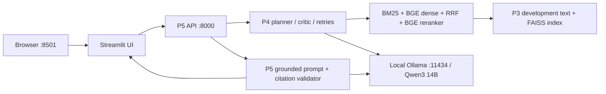
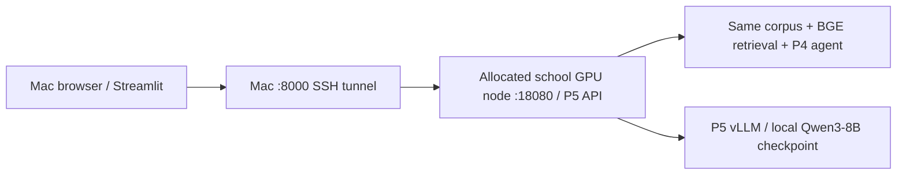

# P6 local end-to-end UI guide

## Saved demo settings — 5 November 2026

The permanent defaults now use **top-8 per retrieval round**, **BGE reranker off**,
and **BM25 + BGE dense + RRF**. BGE embeddings remain enabled. Both the local
Agent hook and the cluster factory receive the same depth; changing only server
`--top-k` is insufficient.

Local setup now obtains `data/processed/passages_all_paper_text.jsonl` and its
manifest from P3, matching P5's all-paper 365/40 package. It uses the separate
`indexes/p6-365-40-bge/` directory and validates corpus/index identity. The old
`p6-development-bge` index is not reused for the larger corpus.

```bash
./scripts/p6-local.sh setup
./scripts/p6-local.sh start
```

Run setup once for the new corpus/index before starting. Setup can take time to
encode the corpus; it does not load held-out QA annotations. Alternatively point
`PAPERGAP_CORPUS` and `PAPERGAP_DENSE_INDEX` in ignored `.env.p6.local` to P5's
already prepared matching corpus and index. Review/remove stale overrides for
`P6_TOP_K`, `DEMO_AGENT_TOP_K` and `DEMO_AGENT_BGE`; explicit overrides still win.
Restart an existing service to apply saved settings. Cluster defaults use
`TOP_K=8`, `DEMO_AGENT_TOP_K=8`, `DEMO_AGENT_BGE=0` and the existing P5 365/40 paths.

This update changes demo defaults only. Earlier real-run evidence below used
the older development corpus/reranked configuration and does not verify the new
runtime. No model/index rebuild or live service restart was performed as part
of this saved-configuration change. Final evaluation freezes remain separate.


Updated 2026-11-02 (Singapore). Target: Apple M5, 24 GB unified memory, no school
GPU access yet. Use the existing `P6/UI-port-integration` checkout. No branch
creation, commit or push is needed. Reviewed source baseline: P6 `e772384`,
which includes main `c232edb`; the local integration described here is uncommitted.
All shared code/documentation is English;
passage schemas and split mappings remain `v0-proposed`.

## 1. Start the prepared UI

From the repository root:

```bash
./scripts/p6-local.sh start
```

Open [the local UI](http://127.0.0.1:8501). This command starts the P5-compatible
API and Streamlit with saved configuration. It uses the **existing Ollama
`qwen3:14b` model**, real P3 text, full-development BGE dense index, BM25, RRF,
BGE reranking, P4's adaptive agent and P5's answer/citation validation.
There are no credentials or file paths to fill in for this machine.

Keep this terminal running. Ctrl+C stops only the API/UI processes created by
this launcher; it leaves the existing Ollama service running. Ollama's model
can remain cached in memory for ten minutes after the last call.

If Ollama has been stopped, start its macOS application first, or use a separate
terminal for `ollama serve`. Do not run another server if Ollama is already
listening on port 11434. No paid API key is needed.

### Layout and controls

The left drawer starts with **NLP Scientific Paper RAG** and **ⓘ How to use**,
then **Connection**, **Search scope**, **History**, and **Advanced settings**.
No workspace creation is required.

The heading is **Ask the paper collection** for All papers,
**Ask Paper 'Selected paper title'** for One paper (ID fallback if no title is supplied),
and **Generate from prepared evidence** in Demo record mode. **Browse all
examples** is the only example entry point; no standalone example buttons remain.
Scope changes apply to the **next** question;
stored results retain their original question and scope.

```text
LEFT DRAWER                         MAIN AREA
NLP Scientific Paper RAG             Ask the paper collection
ⓘ How to use                        Your question [editable input]
Connection                          Ask question
Search scope                        Browse all examples
  All papers / One paper            -----------------------------------
  Optional paper title + ID          Your submitted question + scope
History                             Answer
  Previous questions                Evidence needs review (when flagged)
  + New question                    Sources (expand)
Advanced settings (expand)           Pipeline details (expand)
  Input mode / export / clear        Debug information (expand)
```

**All papers** searches the complete prepared development pool, currently 1,168
papers. **One paper** optionally filters retrieval by its stable ID; the selector
shows both title and ID. Each question stands alone: history is not chat context.
Hover over sidebar controls for explanations.

The question library sits **below the input**. **Browse all examples** groups **Across all papers** and **About a specific
paper**. Every paper-specific option includes the paper title and **Paper ID**.
Click **Use this question**, edit the draft if needed, then **Ask question**.
In All papers mode, paper-specific examples add the title/ID to the question to
clarify references such as “they”; they do not silently enable a paper filter.
In One paper mode, the library shows only matching examples and uses the original
question wording. Download examples there, or read
`results/p6-local/SAMPLE_QUESTIONS.md`.

### Submit a ready-made question

1. Open the UI. Under **Connection**, expect backend `ollama` and model
   `qwen3:14b`. **Refresh service** reloads health/papers, without reloading config.
   Capabilities (retrieval, corpus search, passage text and adaptive agent) can be
   checked through `/health`; retrieval, passage text and agent also appear under
   **Advanced settings**.
2. Keep **Search scope → All papers**. Expand
   **Browse all examples**, select a category/question and **Use this question**.
   For an explicitly filtered QASPER run, select **One paper** and its title/ID.
3. Review **Your question** and click **Ask question**. This runs fresh hybrid
   retrieval and the agent; it is not replay. Wait for the non-streaming response.
4. Read **Your submitted question**, then **Answer** immediately below it.
   Only one selected result is shown. **Evidence needs review** means validation
   returned warning-level issues while retaining the answer. Open **What was
   flagged?** for the exact code/message/severity/subject. A warning may indicate
   unsupported claims or incomplete evidence, or a derived provenance map; it is
   not always a critic failure and is not a correctness score.
5. Expand **Sources** to verify titles, paper IDs, sections and passage text.
   A validator block displays the final refusal as the Answer, with rejected text
   in a separately labelled expander. Missing source text retains its passage ID.
6. Expand **Pipeline details** for backend-supplied round queries, passage IDs,
   timing, critic decisions and the last rewritten query. Two retries permits at
   most three retrieval rounds. Separate BM25/dense rankings and RRF/reranker scores
   are **not supplied** by this API and are not fabricated. **Debug information**
   contains request/client IDs, HTTP timing and raw validation/generation/agent/
   search/provenance metadata.
7. Use **History** directly below Search scope to open a prior result without
   inference. **+ New question** clears only the draft and selected result;
   existing runs remain. A repeated **Ask question** creates a distinct attempt.
   The explicit manual-retry checkbox links another execution of the latest
   matching submission; it does not recover or cancel an earlier request.
8. Under **Advanced settings**, select five useful runs and **Download selected
   runs** for the report. Exports omit the full agent block; save the direct API
   response from section 6 for durable critic/retrieval traces. **Clear history**
   deletes all session runs/drafts; export first. It does not delete the corpus.

History is session-only and may be lost on refresh/reconnect/new tabs. Storage is
bounded to 10 internal mode/scope contexts and 50 attempts per context. At the
limit export, then Clear history; no silent eviction occurs. Calls are synchronous,
with one pending request per session. Timeout means outcome unknown, not cancelled.

For an isolated generation/UI check, open **Advanced settings → Input mode →
Demo record** and select an **Exported record** in the main area, then **Ask
question**. Prepared inputs already contain real passages for the five samples.
Record mode generates a new answer but does **not** rerun retrieval/the adaptive
agent; any trace belongs to the saved input. Switch Input mode back to **Free
question** for the full pipeline. `P5_RECORDS_PATH` is only needed for record mode.
A legitimate refusal is valid; a `GENERATION_ERROR` or transport error needs
investigation. No API token is required for the prepared local configuration.

## 2. What is connected



Note: Swagger UI - http://127.0.0.1:8000/docs

The critic and answer generator share the same Ollama model. Runtime retrieval models
run on CPU; the one-time index build uses Apple MPS. Ollama manages Apple GPU acceleration. This local
quantized 14B setup is a development configuration, not a reproduction of P5's
school Qwen3-8B/vLLM performance. Record model identity and settings separately.
The native Ollama API supports `stream=false` and `think=false`; the adapter
uses both. [Ollama chat API](https://docs.ollama.com/api/chat)

Corpus search uses one corpus-wide BM25 ranking and one global cosine ranking,
then RRF and reranking. The global dense view reuses the saved vectors; no
corpus re-encoding is needed when switching scope. A result may cite one or
several papers depending on relevance.

The P6 UI talks to the P5 API, **not directly to Ollama**. `P5_API_BASE` must
remain port 8000 locally. Port 11434 is only the model endpoint behind that API.

## 3. Files and completed implementation

All paths below are relative to the repository root. The launcher resolves them
to absolute paths automatically, including when called from another directory.

| Location | Purpose |
| --- | --- |
| `scripts/p6-local.sh` | One-command entry point; chooses dedicated environment and limits CPU threads |
| `scripts/p6_local.py` | Data setup, configuration loader, API/agent construction and process lifecycle |
| `configs/p6-local.env` | Complete safe local defaults; read automatically |
| `configs/p6-school.env.example` | Future GPU API override template; account paths/token must be supplied later |
| `configs/p6-school-ui.env.example` | Future Mac tunnel/UI override template |
| `.env.p6.local` | Optional private overrides; ignored by Git; not needed for the prepared defaults |
| `.venv-p6/` | Dedicated Python 3.12 runtime; ignored by Git |
| `requirements-p6-local.txt` | Dependencies for recreating the local runtime |
| `src/generation/generators/ollama_backend.py` | Ollama model availability check, grounded generation, critic chat and model digest/timing metadata |
| `src/generation/server.py` | Optional `record_fn` hook under the existing authentication/concurrency lock; health reports agent capability |
| `src/ui/app.py` | Question-first layout, sidebar title/help/scope/history, grouped sample library, one selected answer, sources and diagnostics |
| `data/processed/passages.jsonl` | Complete P3 development corpus: 21,360 passages, 1,168 indexed papers |
| `data/processed/passages.manifest.json` | P3's source/chunking/count/hash manifest |
| `data/processed/p6-paper-catalog.json` | Titles for all 1,168 indexed papers, generated from the verified corpus |
| `indexes/p6-development-bge/` | Full development dense/FAISS index and its passage metadata |
| `.cache/huggingface/hub/` | Pinned BGE encoder and reranker downloads |
| `results/p6-local/sample-questions.jsonl` | Five previously used P3 development-pilot questions; no held-out annotation pool |
| `results/p6-local/SAMPLE_QUESTIONS.md` | Human-readable sample questions, paper IDs and titles |
| `results/p6-local/demo-records.jsonl` | Prepared real-retrieval input states for Demo record mode |
| `results/p6-local/data-source.json` | P3 source commit, corpus hash/count and sample source |
| `results/p6-local/packages.txt` | Resolved runtime dependency snapshot |
| `results/p6-local/runtime.json` | Last API launch: code hashes, model digest, paths and retrieval settings |
| `results/p6-local/api.log` | API startup and request/error logs from `start` |
| `results/p6-local/fresh-question-smoke.json` | Verified fresh local adaptive HTTP answer and critic trace |
| `results/p6-local/citation-smoke.json` | Source text lookup for that answer's cited passage |
| `tests/test_p6_local.py` | Ollama payload/metadata, saved config and agent HTTP boundary checks |
| `tests/test_ui_p5_smoke.py` | Optional real-service test; AppTest timeout follows the configured LLM timeout |

Models, corpus, indexes, runtime outputs, secrets and virtual environments stay
out of Git. Ollama already manages `qwen3:14b` in its own local model store;
the verified model store on this Mac is `/Users/changyanxu/.ollama/models/`.
Do not edit its blobs manually. There is no Hugging Face Qwen checkpoint path
to discover. Use `ollama list`
for installed model IDs/digests and `ollama ps` for currently loaded models.

### P3 data identity

The setup fetches/reads `origin/p3-qasper-foundation` without switching branches
or merging its data/code into the current branch. It copies only the published
development corpus, companion manifest and five pilot questions into ignored
local directories. Existing differing local artifacts are refused, not overwritten.

Historical development-only setup (superseded by the saved defaults above):
Reviewed P3 commit: `ee9a2df22d1e2b76ab400a37cf6e0df00bc7c44a`.
Corpus SHA-256:
`ecb1c601cdaebcd8e1e6bfeaf43f9cb4867f89e9762799ab06e7901549a9e403`.
Chunking: **365 words / 40-word overlap**, full-text only. QA answers/gold labels
are not indexed. The selected pilot questions include official train/validation
provenance and were already used for development; they are not held-out results.

For raw-data reproduction, read P3's own guide without changing this checkout:

```bash
git show origin/p3-qasper-foundation:data/README.md > /tmp/p3-data-README.md
```

Do not rebuild with legacy 200/40 defaults or combine another corpus with this
index. P1's index format differs from the older provider UI's MiniLM/Pyserini
format; the local runtime uses the maintained P1/P2 BGE pipeline.

## 4. Every configuration variable

`configs/p6-local.env` supplies every required value. Do **not** source it
manually: the Python loader resolves its relative paths. It loads that file,
then optional `.env.p6.local` overrides. Saved configuration deliberately wins
over stale terminal exports. `P6_CONFIG_FILE` selects another override file.

```bash
./scripts/p6-local.sh config
```

This prints effective paths/settings and hides a configured token.

| Variable | Meaning / prepared value |
| --- | --- |
| `P6_BACKEND` | Generator: `ollama`; `mock` for CPU pipeline checks; `vllm` for future GPU host |
| `P6_MODEL` | Installed Ollama ID `qwen3:14b`; for vLLM this becomes the GPU host's checkpoint path |
| `P6_OLLAMA_BASE` | Model service URL `http://127.0.0.1:11434` |
| `P6_OLLAMA_CONTEXT` | Ollama context allocation, 8192 tokens; input plus output must fit |
| `P6_MAX_NEW_TOKENS` | Answer completion budget, 1024; critic uses P4's own shorter budget |
| `P6_API_HOST` | Local API bind address `127.0.0.1`; nonloopback requires a token |
| `P6_API_PORT` | Local API listen port, 8000 |
| `P6_UI_PORT` | Streamlit browser port, 8501 |
| `P6_PIPELINE` | `adaptive` runs P4; `static` performs one hybrid retrieval followed by P5 generation |
| `P6_TOP_K` | Passages per retrieval round, 8; passed explicitly to the local Agent hook |
| `DEMO_AGENT_TOP_K` | Cluster/factory retrieval depth, 8 |
| `P6_INDEX_DEVICE` | `mps` uses the Apple GPU for the one-time dense index build; set `cpu` on machines without MPS |
| `P6_P3_REF` | P3 Git reference used only by `setup` |
| `PAPERGAP_CORPUS` | P3 passage JSONL backing retrieval and citation lookup |
| `PAPERGAP_DENSE_INDEX` | Dense index directory matching that exact corpus |
| `HF_HOME` | Local Hugging Face cache root |
| `DEMO_AGENT_CACHE_FOLDER` | Actual pinned retrieval-model cache directory |
| `DEMO_AGENT_DEVICE` | `cpu` for BGE encoder/reranker |
| `DEMO_AGENT_OFFLINE` | `1` loads prepared pinned BGE snapshots without network access at runtime; setup may download missing snapshots |
| `DEMO_AGENT_BGE` | `0`: optional reranker disabled; BGE dense embeddings retained |
| `DEMO_AGENT_SCOPED` | `1` enables P4's section-scoped retry selection |
| `DEMO_AGENT_MAX_RETRIES` | Maximum additional retrieval attempts, 2 |
| `DEMO_AGENT_CANDIDATE_K` | Candidate depth per BM25/dense source, 20; hybrid RRF uses implementation default 60 |
| `P5_API_BASE` | URL used by the UI; local `http://127.0.0.1:8000` or a future tunnel endpoint |
| `P5_RECORDS_PATH` | Prepared agent/retrieval input records for Demo record mode; not the corpus |
| `P6_SAMPLES_PATH` | Paper-matched development question list displayed in Free question mode |
| `P6_PAPER_CATALOG_PATH` | Local paper-ID-to-title catalog; titles appear beside IDs throughout the UI |
| `P5_ANSWER_TIMEOUT` | UI and local Ollama request read timeout, 900 seconds; timeout does not cancel inference |
| `P5_API_TOKEN` | Blank locally; shared API bearer token when remote/authenticated |
| `P5_AUTH_HEADER` | Blank locally; `Authorization` when using that bearer token |
| `P5_AUTH_SCHEME` | Blank locally; `Bearer` when using that bearer token |

No `OPENAI_API_KEY` is needed. Ollama has no local model API token here.
The default loopback-only P5 API has no bearer token requirement.

Optional example: to isolate static retrieval, create this ignored file, restart
and remove the override when finished:

```bash
cat > .env.p6.local <<'ENV'
P6_PIPELINE=static
ENV
./scripts/p6-local.sh start
```

Do not replace an existing private override file without checking its contents.
Changing config requires restarting the API/UI; Refresh service does not reload
process environment or models. Review runtime metadata to confirm actual settings.

## 5. Setup/rebuild commands for a new machine

The prepared machine should only need section 1. These commands document how to
recreate its environment and artifacts; initial model downloads and encoding
can take time. Dense setup exposed a native OpenMP conflict in both tested Python runtimes.
The launcher uses a dedicated Python 3.12 environment and forces
`OMP_NUM_THREADS=1` plus `TOKENIZERS_PARALLELISM=false` before importing
Torch/FAISS. Keep these settings for this tested macOS wheel combination. The one-time
`p6_fix_openmp.py` repair also makes FAISS share Torch’s OpenMP library inside
this virtualenv and preserves the original FAISS library; evidence is in
`results/p6-local/native-runtime.json`. No system libraries are changed.

```bash
python3.12 -m venv .venv-p6
.venv-p6/bin/python -m pip install -r requirements-p6-local.txt
.venv-p6/bin/python scripts/p6_fix_openmp.py
git fetch origin p3-qasper-foundation
./scripts/p6-local.sh setup
ollama list
./scripts/p6-local.sh start
```

`setup` verifies corpus SHA-256 and Passage schema/count, builds the **full**
development index when absent, checks corpus equality when it already exists,
loads the pinned BGE reranker and prepares five input records using real hybrid
retrieval. It saves package versions and data provenance locally. It does not
silently replace a different corpus or nonempty incompatible index.

On a new machine without the model, install native macOS Ollama and run
`ollama pull qwen3:14b`. For a smaller machine choose another installed model
and set `P6_MODEL` in the private override file; this changes the experiment.
The prepared Mac already has 14B, so no extra Qwen download is required.
See [Ollama models](https://ollama.com/library/qwen3).

For retrieval-only debugging without local Qwen inference, set
`P6_BACKEND=mock` in the private override. This still performs real hybrid
retrieval/agent wiring but must be labelled mock generation.

## 6. Verify and debug

### Automated checks

```bash
OMP_NUM_THREADS=1 TOKENIZERS_PARALLELISM=false .venv-p6/bin/python -m pytest -q tests/test_corpus_search.py tests/test_p6_local.py tests/test_demo.py tests/test_server.py tests/test_ui_api_client.py tests/test_ui_view_models.py tests/test_ui_record_loader.py tests/test_ui_conversation_state.py tests/test_ui.py tests/test_ui_p5_smoke.py tests/test_legacy_ui_adapters.py
.venv-p6/bin/python scripts/smoke_demo_server.py
```

Most tests are synthetic/CPU contract checks. The running-service test is opt-in
and skipped by default. Against the prepared running API, set configuration
inside Python before invoking it:

```bash
.venv-p6/bin/python - <<'PY'
from scripts.p6_local import configure
import pytest
import os
configure()
os.environ['P5_RUN_SMOKE'] = '1'
raise SystemExit(pytest.main(['-q', 'tests/test_ui_p5_smoke.py::test_actual_p5_service']))
PY
```

That smoke submits two records and consumes real inference time. Run it while
the service is idle. Record mode does not establish fresh agent execution.

### Direct API test with the first saved question

Keep `start` running, then use another terminal:

```bash
.venv-p6/bin/python - <<'PY'
import json
from pathlib import Path
import os
import requests
from scripts.p6_local import configure, RUNTIME, write_json
configure()
base = os.environ['P5_API_BASE']
print(requests.get(base + '/health', timeout=10).json())
q = {'question': 'What methods are used for low-resource language identification?'}
headers = {}
if os.environ['P5_API_TOKEN']:
    headers['Authorization'] = 'Bearer ' + os.environ['P5_API_TOKEN']
r = requests.post(base + '/answer', json={'question': q['question']},
                  headers=headers, timeout=(5, float(os.environ['P5_ANSWER_TIMEOUT'])))
r.raise_for_status()
write_json(RUNTIME / 'fresh-question-smoke.json', r.json())
print(json.dumps(r.json(), indent=2))
PY
```

Check real backend/model/digest, validation violations, returned citation IDs
and fresh `agent` critic/retrieval traces. HTTP 200 alone does not prove model
inference: `EMPTY_CONTEXT` and `AGENT_INSUFFICIENT` can skip final generation.
A valid refusal is different from `GENERATION_ERROR`, invalid JSON or timeout.

| Symptom | First check |
| --- | --- |
| UI/API does not start | `results/p6-local/api.log`; port 8000/8501 may already belong to another process |
| Model unavailable | `ollama list`; `ollama ps`; confirm Ollama app is running and configured ID exists |
| Slow requests / memory pressure | Activity Monitor; one request at a time; inspect agent rounds and `ollama ps` |
| Corpus/index mismatch | Run `setup`; do not mix 365/40 corpus with another chunking/index |
| Curl/Python works but UI fails | Streamlit terminal traceback, selected paper, API URL and auth settings |
| Refusal / validator rejection | Expand validation/raw diagnostics; inspect the evidence before changing prompts |
| 401 | API and UI must use the same token/header/scheme |
| 429 | Another answer is running; wait and retry manually |
| Timeout | Outcome unknown; the request may continue on the server; no automatic POST retry |
| Citation text missing | Verify passage-text health flag and returned IDs against the configured corpus |

The browser talks to Streamlit; Python makes the API calls. Browser Network
normally will not show `/answer`. For breakpoints use the UI API client,
server `_one_at_a_time`, `src/agent/demo.py`, hybrid `retrieve`, or the Ollama
adapter. Keep tokens and real dataset dumps out of shared logs/screenshots.

Manual browser checks remain necessary: sample insertion, citation expansion,
session/history isolation, scope changes, duplicate submissions, rejected-answer display and exports.
Refresh/reconnect can lose session history; download useful runs before closing.

## 7. Later: connect a school GPU model

P5's supplied `启动集群.md` describes an existing **record-only** deployment
(`retrieval=false`), not the full pipeline below. The UI can connect to that
service through config/tunnel and Demo record, but cannot enable missing retrieval
through configuration. See [handoff section 2.0](P6_UI_handoff.md#20-compatibility-with-p5s-supplied-cluster-guide)
for that minimal route and the capability comparison. The following is route B.

Keep the **same P6 UI and HTTP contract**. Move the API, hybrid indexes and agent
to the GPU host, substitute P5's vLLM generator, then tunnel its API to the Mac.
Do not point the UI at a raw vLLM/OpenAI model endpoint.



This is a **future deployment recipe, not a tested school run**. Obtain your own
cluster access/allocation, approved model path/revision, pinned vLLM environment
and storage first. Use P5's existing environment; do not install the laptop
Torch/dependency snapshot into it. The GPU environment also needs the compatible
retrieval/agent/API dependencies used by this runtime. Review changes with P4/P5.
Never run model inference on a login node.

On the allocated GPU runtime, use the same reviewed code and verified corpus,
index and BGE cache. Copy these ignored artifacts through an approved path; they
are not supplied by a Git push. Copy the prepared template, then replace its
account-specific paths and shared token:

```bash
cp configs/p6-school.env.example .env.p6.school
```

The private `.env.p6.school` should contain:

```dotenv
P6_BACKEND=vllm
P6_MODEL=/approved/absolute/path/to/Qwen3-8B
P6_API_HOST=0.0.0.0
P6_API_PORT=18080
P5_API_TOKEN=replace-with-your-private-shared-token
P5_AUTH_HEADER=Authorization
P5_AUTH_SCHEME=Bearer
PAPERGAP_CORPUS=/approved/runtime/data/passages.jsonl
PAPERGAP_DENSE_INDEX=/approved/runtime/indexes/p6-development-bge
HF_HOME=/approved/runtime/cache/huggingface
DEMO_AGENT_CACHE_FOLDER=/approved/runtime/cache/huggingface/hub
```

Replace those account-specific future paths/token when access is available.
Inside the GPU allocation, activate the P5-compatible environment and run:

```bash
P6_CONFIG_FILE=.env.p6.school python -u -m scripts.p6_local serve
```

Use this command in a site-approved Slurm job with P5's GPU/account/partition
settings and sufficient resources, not an interactive login-node shell. The
original `80_demo_server.sbatch` still invokes the original P5 CLI; merely setting
`P6_BACKEND` there does not select this local-runtime entry point or its agent hook.
P5's existing script remains a valid static/record service alternative if explicitly
configured, but has a different launch path. Verify backend/model/agent health.

On the laptop, forward through the login node to the actual allocated node,
using P5's measured TCP-forwarding form (confirm your account permits it):

```bash
ssh -N -o ExitOnForwardFailure=yes -o ServerAliveInterval=30 \
  -L 127.0.0.1:8000:ACTUAL_COMPUTE_NODE:18080 YOUR_USER@YOUR_LOGIN_HOST
```

Keep that terminal running. Stop the local API before using port 8000 for the
tunnel. On the Mac copy the UI template and fill the same token:

```bash
cp configs/p6-school-ui.env.example .env.p6.school-ui
```

The private `.env.p6.school-ui` should contain:

```dotenv
P5_API_BASE=http://127.0.0.1:8000
P5_API_TOKEN=the-same-private-shared-token
P5_AUTH_HEADER=Authorization
P5_AUTH_SCHEME=Bearer
```

Then launch only Streamlit, with health verification and no local API process:

```bash
P6_CONFIG_FILE=.env.p6.school-ui ./scripts/p6-local.sh remote
```

The Mac retains the prepared sample question and Demo record paths. Ensure the
remote corpus uses identical passage IDs. Re-read node/logs and rebuild the
tunnel after a job changes. When finished, stop UI/tunnel and cancel only your
own recorded Slurm job. Keep local Ollama and school vLLM results separate.

## 8. Execution evidence

Corpus-wide scope details and compatibility/review points are in
[CORPUS_SEARCH_CONTRACT.md](CORPUS_SEARCH_CONTRACT.md). Earlier measurements
below used an explicit paper filter; corpus-wide evidence is recorded separately.

Preparation and verification results for this working tree are recorded below
when completed. Source has uncommitted changes: runtime metadata includes code
hashes as well as Git HEAD. No commit or push is required to test it.

- P3 corpus copied locally and SHA-256/count verified: complete.
- Local Ollama model availability: `qwen3:14b`, digest
  `bdbd181c33f2ed1b31c972991882db3cf4d192569092138a7d29e973cd9debe8`.
- Full dense index: complete; metadata confirms 21,360 passages / 1,168 papers.
  Built with pinned BGE-small revision `5c38ec7c405ec4b44b94cc5a9bb96e735b38267a`
  on Apple MPS; runtime encoding/reranking uses CPU.
- BGE reranker (revision `2cfc18c9415c912f9d8155881c133215df768a70`)
  and five real-retrieval Demo record inputs: complete. Runtime
  loads the prepared encoder/reranker snapshots offline.
- Real Qwen/P5 generation: passed on a synthetic warm-up input with no validator
  violations; saved in `results/p6-local/ollama-generation-smoke.json`.
- Actual browser: sample insertion, fresh submission, displayed answer, expanded
  citation/source text and diagnostics passed. One observed browser request took
  77,779 ms across three retrieval rounds; this is one HTTP measurement, not a
  benchmark. Screenshot: `output/playwright/p6-local-answer.png`.
- Fresh adaptive HTTP: saved in `results/p6-local/fresh-question-smoke.json`;
  all three critic entries have `source=llm`, empty errors and no thinking drift.
  The answer generated real text and its cited passage resolved successfully;
  lookup evidence is `results/p6-local/citation-smoke.json`.
- This sample retained warnings `GENERATED_WITH_INSUFFICIENT_EVIDENCE` and
  `UNCOVERED_REQUIRED_COMPONENT`: the critic requested more method evidence,
  while P5 answered from the available cited passage. The UI correctly showed
  the then-current **Answer with warnings** banner (now **Evidence needs review**). This is a calibration/quality observation, not a
  transport, parse or model availability failure; it is not a clean semantic pass.
- Relevant synthetic regression suite: 83 passed, 1 opt-in service test skipped.
  The separate opt-in real-service UI smoke also passed (1 test, two actual
  Ollama calls, 65.14 seconds). Its AppTest harness now uses the configured
  LLM timeout instead of the default three seconds.
  P5 mock-service socket smoke: all checks passed. Bash/Python command syntax,
  new-module lint and `git diff --check` also passed.
- School GPU execution: not run; no current access.
- Corpus-wide real hybrid retrieval: passed; one topic query returned five
  passages across four distinct papers. Evidence:
  `results/p6-local/corpus-retrieval-smoke.json`.
- Corpus scope, paper-filter compatibility, global BM25 statistics, saved-vector
  dense search and source identities are covered in `tests/test_corpus_search.py`.

### Corpus-wide execution update

- Integrated corpus/P1/P2/P4/P5/UI regression suite: **285 passed, 1 optional
  running-service check skipped** after the native OpenMP repair.
- A real Streamlit AppTest submitted a new topic question with no `paper_id`,
  through the live P5 API and local Qwen model. It completed in 79.42 seconds,
  retrieved from four papers, and cited passages from two papers. Scope/filter
  metadata, LLM critic execution, real generation and citation lookup passed.
- That answer retained `UNSUPPORTED_CLAIM`; the model mixed related task context.
  This establishes the cross-paper wiring, not semantic correctness. Inspect
  warnings and sources before using an answer in a report.
- Evidence: `results/p6-local/corpus-ui-run.json`,
  `results/p6-local/corpus-fresh-question-smoke.json`, and
  `results/p6-local/corpus-retrieval-smoke.json`.
- Browser verified **Search scope → All papers** by default, with **One paper**
  available as an optional filter. The approved redesign now applies scope directly
  to the next submission; each saved result keeps its original scope.

### Approved UI redesign verification — 2026-11-02

- Implemented the approved drawer/input/answer order, History below Search scope,
  and paper IDs alongside titles in paper-specific examples. Removed obsolete
  workspace setup/removal controls, the stacked-result loop and duplicate sample
  selection UI. Preserved shared state interfaces and reusable legacy adapters.
- Integrated UI/API/agent/corpus/legacy-adapter checks: **98 passed, 1 optional
  running-service test skipped**. Synthetic HTTP checks do not establish model quality.
- Browser checked the real UI at desktop 1,200 px and narrow 390 px. At narrow
  width, both document and main scroll widths were 390 px, without horizontal
  overflow. Screenshots are local under `output/playwright/p6-redesign-*.png`.
- A real All papers request used the Gating Mechanisms development example with
  its title/ID in the question. It completed in **75.16 seconds**, with three
  retrieval rounds and three source papers before final prompt selection. The
  result was a **model refusal**, with `GENERATED_WITH_INSUFFICIENT_EVIDENCE`
  and zero cited passages. No generation/parser/transport error appeared in the
  rendered diagnostics. This verifies execution and presentation, not scientific
  correctness. Inspect the critic/evidence diagnostics before changing prompts.
- Fixed loading-state rendering so submit, draft, scope/history and example
  selection are disabled before answer HTTP begins; a regression checks this
  during dispatch. No automatic retries or cancellation endpoint were added.
- No new branch, commit or push. School GPU execution remains unverified.
