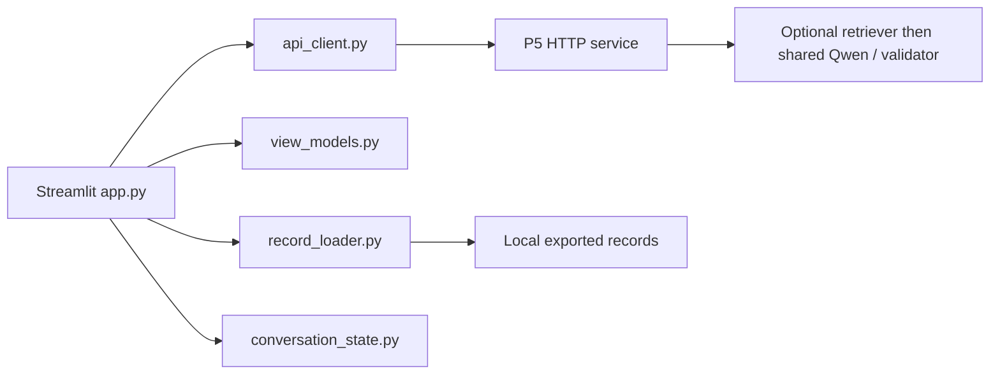

# UI port: requirements and architecture

Status: implemented local UI specification, reviewed against code `4584e2c` and
P5 contract `ef5f7a3` on main `97e33b2` after rebase (2026-10-29).
See [completion evidence](UI_PORT_COMPLETION_SUMMARY.md) for executed tests.

## Objective and ownership

Option C uses a GPU-node P5 service and a laptop HTTP-client UI. P6 now submits
its own cluster job and operates its own tunnel/Streamlit, per P5's latest message.
P5 owns server/model configuration, P1/P2 own retrieval, P4 owns AgentState/agent
logic, and P6 owns the UI and deployment rehearsal. Local UI/mock development
requires no GPU, model weights, cluster credentials, Java or retrieval indexes.

The UI exposes grounding/validation behavior, not answer correctness. The demo's
100-question pool has no gold answers supplied for UI scoring. Passage schemas
and split mappings remain `v0-proposed`. Interface changes need affected-owner
review; this port preserves existing shared answer and passage formats.

## Current checkout and prerequisites

The branch was rebased onto main `97e33b2`, including P5 service `ef5f7a3`. The
old provider/index UI has been replaced. Reusable legacy modules remain for their
other callers. The combined checkout now includes:

- [Field-level contract](../P6_UI_CONTRACT.md) and [P5 operations manual](../DEMO_OPTION_C.md).
- `src/generation/server.py` (shared-repository import path).
- `examples/demo_ui_responses.json`, `scripts/capture_demo_responses.py`,
  `scripts/smoke_demo_server.py` and `scripts/cluster/80_demo_server.sbatch`.
- P6's lightweight UI modules and tests. Runtime requirements include Streamlit,
  requests and retained OpenAI/Pydantic declarations for existing consumers.

Confirmed contract: `/papers` returns string IDs; UI normalizes these to internal
paper_id objects. Auth is Authorization: Bearer on protected endpoints when a
server token is set. Health carries boolean capability flags plus backend/model/
prompt information, but no mode field. Violation objects carry code/severity/
message/subject. The shared mock command is `python -m src.generation.server --backend mock`;
do not use the separate standalone `nlp_p5` package path.

There is no `/records` endpoint. `P5_RECORDS_PATH` is implemented as a local JSON
array/JSONL source; shape checks do not establish that every row is an approved
real AgentState. Account-specific runtime paths and development inputs still need
P6/P5 confirmation. Free-query retrieval needs P2/P5's real factory and data/index
configuration, which are not supplied. The free-query endpoint currently does
one retrieval call and generation, not a fresh P4 adaptive-agent run.

See [execution semantics](UI_PORT_USER_STORIES_AND_API.md) for IDs and
[real-environment guide](P6_REAL_ENV_E2E_GUIDE.md) for operational prerequisites.

## Functional requirements

| ID | Requirement |
| --- | --- |
| R01 | Read `P5_API_BASE`, defaulting to `http://127.0.0.1:8000`; normalize trailing slash and validate HTTP(S). Display connection/capability status and offer explicit refresh. |
| R02 | Query `/health`. Unknown/unreachable capabilities disable dependent actions until a successful refresh. `retrieval=false` disables free-question submission with a reason. |
| R03 | Support selecting an exported record from a configured local file (`P5_RECORDS_PATH`). Show selected record label/question for confirmation and preserve its original identifiers and submit the original record as `{"record": ...}`. Do not fabricate AgentState fields. |
| R04 | When retrieval is available, load `/papers`, select a paper, and submit nonblank question plus `paper_id`. Record and question request bodies are mutually exclusive. Empty paper lists disable free submission. |
| R05 | Render `request_id`, all five `result` fields, validation details, generation metadata, and optional agent trace. Do not require `agent` on free-input responses. |
| R06 | Distinguish normal, warning, empty-context refusal, agent refusal, model refusal, and validator downgrade. Refusal is a successful HTTP 200 outcome. |
| R07 | A downgrade prominently shows the final refusal and reason, with the original model answer clearly labeled as rejected in an expander. Never present rejected content as the accepted answer. |
| R08 | Resolve citation IDs using `/passages` only when `passage_text=true`. Preserve IDs and show text/title/paper/section if returned; missing IDs show “Passage text unavailable”. Missing corpus/503 preserves the answer and IDs. |
| R09 | Submit at most once per user action; show spinner, disable submission while pending, and set answer timeout to at least 120 seconds. No streaming or automatic answer retries. |
| R10 | Distinguish 400, 401, 429, 503, timeout, connection failure, malformed JSON, and invalid success payload. Show actionable messages; 429 asks for a manual retry after about 20 seconds. Do not erase the previous successful result on failure. |
| R11 | Keep questions and execution attempts in per-conversation session history. Display reruns, citation expansion, and health refresh must not call `/answer` again. Clear removes only the selected non-pending conversation history and its evidence/errors; it never cancels inference. Changing inputs must not relabel an earlier result. |
| R12 | Keep tokens, raw datasets, captured production results, weights, and indexes out of Git. Render external text as text/standard Markdown without unsafe HTML; never expose credentials or raw exception dumps. |
| R13 | Isolate UI sessions, conversations, messages and execution attempts using distinct local UUIDs. Treat P5 request_id as a business/question identifier, never the unique execution key. |
| R14 | Bind each free-query workspace to one paper; questions are independent, with no implied model memory. Demo-record mode is separate. Keep session-only history; no cross-tab/refresh persistence promise. |
| R15 | Route every response and citation lookup to the captured owning run. Identical queries/retries create distinct attempts; late or duplicate completions cannot overwrite another run. |
| R16 | Track completed, rejected, failed and outcome_unknown separately from answer classification. Timeout/disconnect may leave server work running; no automatic retry/cancellation/recovery claim. |
| R17 | Record answer HTTP elapsed time separately from citation lookup and export five selected runs with timing definitions and available reproducibility metadata, without credentials. |
| R18 | Preserve P5 request/response schemas. Client-run and backend-run headers require P5 agreement; operate with local correlation if unsupported. |

Final refusal classification uses `result.evidence_status`; `validation.downgraded`
takes precedence for the downgrade presentation. Among insufficient cases, inspect
documented violation codes `EMPTY_CONTEXT` then `AGENT_INSUFFICIENT`, otherwise
show model refusal. A sufficient response with non-warning violations or contradictory downgrade
metadata is displayed as inconsistent. Missing/invalid required field types or
evidence-status values are rejected as invalid success payloads before rendering.
The parser checks required container/field types and preserves the response.
Other insufficient-result codes fall back to Model refusal; inspect diagnostics
for generation/parser failures before claiming real-model success.

## Implemented code architecture

The following interfaces exist in the current implementation.

| Module | Functions/types and responsibilities |
| --- | --- |
| `src/ui/api_client.py` | `ApiConfig.from_env()` loads URL, timeout and confirmed token settings. `P5ApiClient.health()`, `.papers()`, `.answer_record(record)`, `.answer_question(question, paper_id)`, `.passages(ids)` centralize HTTP requests. `_request()` maps transport failures to `ApiError(kind, message, status=None)` without retrying POST. Inject a requests session for tests. |
| `src/ui/view_models.py` | `parse_answer_record(payload)` checks required containers and five result keys while retaining optional/unknown metadata. `classify_answer(record)` returns the six supported display states plus an inconsistent-response state. `citation_ids(record)` deduplicates IDs without parsing hash contents. `build_evidence_cards(ids, payload)` preserves unresolved IDs. No networking or Streamlit imports. |
| `src/ui/record_loader.py` | `load_records(path)` reads a local JSON/JSONL file, validates container shape, reports invalid rows with line/index, and preserves record objects. `record_label(record, index)` creates a stable selector label using contract-confirmed identifiers. Do not log record bodies. |
| `src/ui/conversation_state.py` | `new_session()`, `create_conversation()`, `begin_run()`, `finish_run()`, `attach_evidence()`, `clear_conversation()` own pure state transitions and captured result routing. `export_runs()` emits sanitized selected-run JSON with timing definitions. |
| `tests/test_ui_conversation_state.py` | Identity isolation, repeated queries, timeout/retry lineage, late completions, clearing and export. |
| `src/ui/app.py` | `main()`, `refresh()`, `submit_request()`, `render_answer()` orchestrate session state and client calls; no direct model/index imports. |
| `tests/test_ui_api_client.py` | Request shapes, timeout, status/error handling, and no automatic retry. |
| `tests/test_ui_view_models.py` | State classification, invalid payloads, citation fallback, optional metadata. |
| `tests/test_ui_record_loader.py` | JSON/JSONL records, malformed rows, preservation of exported state. |
| `tests/test_ui.py` | Streamlit AppTest workflows; reusable legacy adapter checks now live in tests/test_legacy_ui_adapters.py. |
| `tests/test_ui_p5_smoke.py` | Opt-in real local P5 mock-service HTTP path; must fail clearly when explicitly requested without its prerequisites. |

Streamlit session keys include `workspace_state`, `health`, `papers`, and
`connection_error`. `workspace_state` owns `ui_session_id`, `conversations`,
`active_conversation_id`, and `pending_client_run_id`. Each conversation owns its
mode, paper binding and run map; message_id is stored on each run, not in a
separate message store. Each run owns an immutable submission
snapshot, outcome, answer record, timings, error and evidence map. See the linked
execution contract for lifecycle and bounded history. A pending flag is local UI
protection; P5's 429 remains authoritative across sessions. No global answer cache.
The synchronous client captures IDs before dispatch and writes only to their owner.
Browsing during a blocking Streamlit request is not promised without verification.

`requirements-ui.txt` includes Streamlit and requests; OpenAI/Pydantic remain for
existing callers/tests. The new UI does not import model or retrieval modules.
P5 server dependencies are separate from the lightweight UI environment.

## Scope and review decisions

In scope: API client, exported-record workflow, capability-gated free questions,
six answer states, citations, diagnostics, session-only conversation history,
run isolation, five-query timing export, failures, tests and handoff.
Out of scope: implementing P2 retrieval, changing P5 validation, serving Qwen,
changes to cluster/service infrastructure, gold-answer scoring, streaming,
contextual multi-turn generation, asynchronous task APIs, cancellation, cross-tab synchronization, and persistent history.

Design review and local implementation are complete; actual P5 mock integration
passed. P6 cluster operation is documented but not executed. Optional correlation
headers and backend run IDs remain deferred, not required for local result routing.
Real deployment acceptance requires the evidence listed in the E2E guide.
