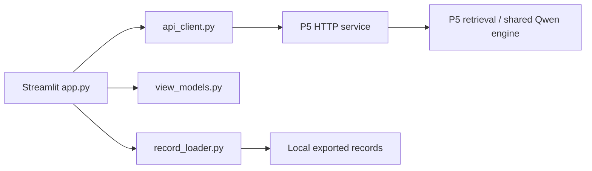

# UI port: requirements and architecture

## Objective and ownership

Implement P5's Option C: P5 operates the cluster job, model, backend, SSH tunnel,
and Streamlit on P5's laptop. P6 delivers a lightweight Streamlit API client,
tests, and deployment instructions. P6 develops with a local mock service without
GPU, model weights, cluster credentials, Java, or retrieval indexes.

The UI must expose grounding and validator behavior without claiming answer
correctness. The 100 demo questions have no gold answers supplied for this UI.
Passage schemas and split mappings remain `v0-proposed`; this work does not
approve or change them. P5 owns answer schemas, P4 owns AgentState, and P1/P2
own retrieval. Interface discrepancies require affected-owner review, not a
second backend or a silent schema translation.

## Current checkout and prerequisites

At planning time, `src/ui/app.py` is the legacy provider/index UI, using
`src.generation.llm_client` and `src.ui.services`. Its configuration and tests
do not implement the new P5 HTTP contract. `requirements-ui.txt` includes
Streamlit, OpenAI, and Pydantic. Keep legacy adapter modules available for their
existing callers; replacing the UI must not delete unrelated generation logic.

The new handoff's server, contract, architecture document, capture script, and
response samples are absent from the current checkout. Before service-backed
integration, obtain P5's branch/commit containing:

- `docs/P6_UI_CONTRACT.md` and `docs/DEMO_OPTION_C.md`.
- `src/nlp_p5/server.py` and service installation instructions.
- `examples/demo_ui_responses.json` and `scripts/capture_demo_responses.py`.
- An approved exported AgentState sample and its local selection/loading path.

Confirm with P5: exact `/papers` row fields, violation severity/code encoding,
health fields beyond the two capability flags, token header and environment
variable, mock launch command for the shared repository, and how to trigger
each captured scenario. Do not assume the standalone `nlp_p5` import path works
in the shared `src.generation` package. No `/records` endpoint is documented:
the proposed record source is a local P5-provided JSON/JSONL file.

See [user stories and execution contract](UI_PORT_USER_STORIES_AND_API.md) for
the handout mapping, multi-workspace layout, ID lifecycle and P5 decision matrix.

## Functional requirements

| ID | Requirement |
| --- | --- |
| R01 | Read `P5_API_BASE`, defaulting to `http://127.0.0.1:8000`; normalize trailing slash and validate HTTP(S). Display connection/capability status and offer explicit refresh. |
| R02 | Query `/health`. Unknown/unreachable capabilities disable dependent actions until a successful refresh. `retrieval=false` disables free-question submission with a reason. |
| R03 | Support selecting an exported record from a configured local file (`P5_RECORDS_PATH`, proposed). Show record ID/question for confirmation and submit the original record as `{"record": ...}`. Do not fabricate AgentState fields. |
| R04 | When retrieval is available, load `/papers`, select a paper, and submit nonblank question plus `paper_id`. Record and question request bodies are mutually exclusive. Empty paper lists disable free submission. |
| R05 | Render `request_id`, all five `result` fields, validation details, generation metadata, and optional agent trace. Do not require `agent` on free-input responses. |
| R06 | Distinguish normal, warning, empty-context refusal, agent refusal, model refusal, and validator downgrade. Refusal is a successful HTTP 200 outcome. |
| R07 | A downgrade prominently shows the final refusal and reason, with the original model answer clearly labeled as rejected in an expander. Never present rejected content as the accepted answer. |
| R08 | Resolve citation IDs using `/passages` only when `passage_text=true`. Preserve IDs and show text/title/paper/section if returned; missing IDs show “Passage text unavailable”. Missing corpus/503 preserves the answer and IDs. |
| R09 | Submit at most once per user action; show spinner, disable submission while pending, and set answer timeout to at least 120 seconds. No streaming or automatic answer retries. |
| R10 | Distinguish 400, 401, 429, 503, timeout, connection failure, malformed JSON, and invalid success payload. Show actionable messages; 429 asks for a manual retry after about 20 seconds. Do not erase the previous successful result on failure. |
| R11 | Keep questions and execution attempts in per-conversation session history. Display reruns, citation expansion, and health refresh must not call `/answer` again. Clear removes only the selected non-pending conversation history and its evidence/errors; it never cancels inference. Changing inputs must not relabel an earlier result. |
| R12 | Keep tokens, raw datasets, captured production results, weights, and indexes out of Git. Render external text as text/standard Markdown without unsafe HTML; never expose credentials or raw exception dumps. |
| R13 | Isolate UI sessions, conversations, messages and execution attempts using distinct local UUIDs. Treat P5 request_id as a business identifier until its uniqueness is confirmed. |
| R14 | Bind each free-query workspace to one paper; questions are independent, with no implied model memory. Demo-record mode is separate. Keep session-only history; no cross-tab/refresh persistence promise. |
| R15 | Route every response and citation lookup to the captured owning run. Identical queries/retries create distinct attempts; late or duplicate completions cannot overwrite another run. |
| R16 | Track completed, rejected, failed and outcome_unknown separately from answer classification. Timeout/disconnect may leave server work running; no automatic retry/cancellation/recovery claim. |
| R17 | Record answer HTTP elapsed time separately from citation lookup and export five selected runs with timing definitions and available reproducibility metadata, without credentials. |
| R18 | Preserve P5 request/response schemas. Client-run and backend-run headers require P5 agreement; operate with local correlation if unsupported. |

Final refusal classification uses `result.evidence_status`; `validation.downgraded`
takes precedence for the downgrade presentation. Among insufficient cases, inspect
documented violation codes `EMPTY_CONTEXT` then `AGENT_INSUFFICIENT`, otherwise
show model refusal. If a sufficient response contains non-warning violations or
unknown required values, flag an inconsistent response rather than label it clean.
The exact violation object parser is pending P5's field-level contract.

## Proposed code architecture

The following names are proposed implementation interfaces, not existing code.

| Module | Functions/types and responsibilities |
| --- | --- |
| `src/ui/api_client.py` | `ApiConfig.from_env()` loads URL, timeout and confirmed token settings. `P5ApiClient.health()`, `.papers()`, `.answer_record(record)`, `.answer_question(question, paper_id)`, `.passages(ids)` centralize HTTP requests. `_request()` maps transport failures to `ApiError(kind, status, safe_message)` without retrying POST. Inject a requests session for tests. |
| `src/ui/view_models.py` | `parse_answer_record(payload)` checks required containers and five result keys while retaining optional/unknown metadata. `classify_answer(record)` returns the six supported display states plus an inconsistent-response state. `citation_ids(record)` deduplicates IDs without parsing hash contents. `build_evidence_cards(ids, payload)` preserves unresolved IDs. No networking or Streamlit imports. |
| `src/ui/record_loader.py` | `load_records(path)` reads a local JSON/JSONL file, validates container shape, reports invalid rows with line/index, and preserves record objects. `record_label(record, index)` creates a stable selector label using contract-confirmed identifiers. Do not log record bodies. |
| `src/ui/conversation_state.py` | `new_session()`, `create_conversation()`, `begin_run()`, `complete_run()`, `reject_run()`, `fail_run()`, `mark_outcome_unknown()`, `attach_evidence()`, `clear_conversation()` own pure state transitions and captured result routing. `export_runs()` emits sanitized selected-run JSON with timing definitions. |
| `tests/test_ui_conversation_state.py` | Identity isolation, repeated queries, timeout/retry lineage, late completions, clearing and export. |
| `src/ui/app.py` | `main()`, `render_connection()`, `render_request_form()`, `submit_request()`, `render_answer()`, `render_evidence()`, `render_diagnostics()` orchestrate session state and client calls; no direct model/index imports. |
| `tests/test_ui_api_client.py` | Request shapes, timeout, status/error handling, and no automatic retry. |
| `tests/test_ui_view_models.py` | State classification, invalid payloads, citation fallback, optional metadata. |
| `tests/test_ui_record_loader.py` | JSON/JSONL records, malformed rows, preservation of exported state. |
| `tests/test_ui.py` | Replace obsolete entry-point expectations with Streamlit AppTest coverage; preserve still-relevant provider/retrieval unit tests in separate files. |
| `tests/test_ui_p5_smoke.py` | Opt-in real local P5 mock-service HTTP path; must fail clearly when explicitly requested without its prerequisites. |

Proposed session keys: `ui_session_id`, `health`, `papers`, `conversations`,
`active_conversation_id`, and `pending_client_run_id`. Each conversation owns its
mode, paper binding, messages and run map. Each run owns an immutable submission
snapshot, outcome, answer record, timings, error and evidence map. See the linked
execution contract for lifecycle and bounded history. A pending flag is local UI
protection; P5's 429 remains authoritative across sessions. No global answer cache.
The synchronous client captures IDs before dispatch and writes only to their owner.
Browsing during a blocking Streamlit request is not promised without verification.

`requirements-ui.txt` will include the lightweight HTTP client and Streamlit.
Remove UI-only OpenAI/Pydantic requirements only after checking other consumers
and the dedicated test setup. Service dependencies remain P5-owned and separate.

## Scope and review decisions

In scope: API client, exported-record workflow, capability-gated free questions,
six answer states, citations, diagnostics, session-only conversation history,
run isolation, five-query timing export, failures, tests and handoff.
Out of scope: implementing P2 retrieval, changing P5 validation, serving Qwen,
cluster/tunnel operation, gold-answer scoring, streaming, contextual multi-turn generation, asynchronous
task APIs, cancellation, cross-tab synchronization, and persistent history.

Review the proposed local record-file workflow, replacement of the legacy UI
entry point, and architecture before implementation. The current mock and real
service integration cannot be called verified until P5 supplies its artifacts.
